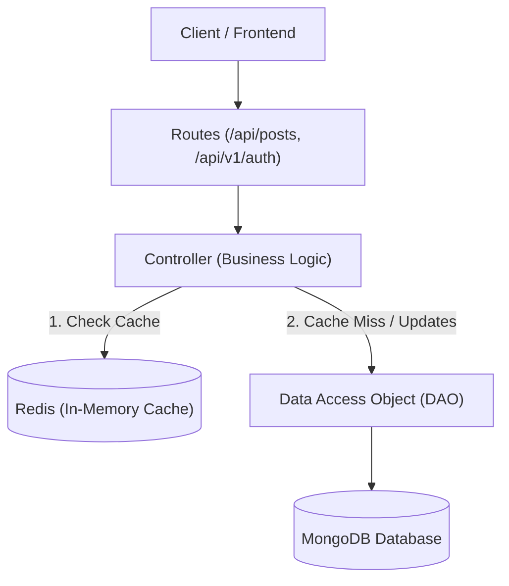
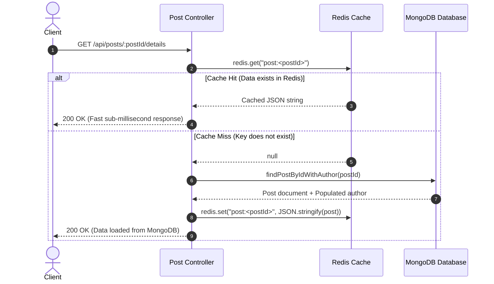
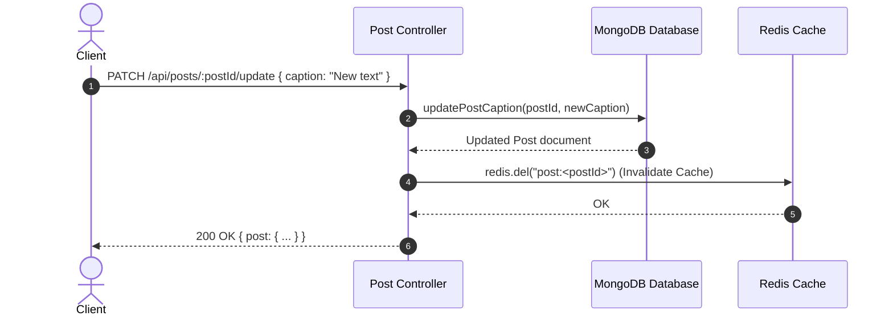

# 🚀 Redis Caching & High-Performance Node.js Backend

A scalable, production-grade Express REST API featuring **Multi-Core Clustering**, **JWT Authentication with Refresh Token Rotation**, and **Redis Caching (Cache-Aside Pattern)** over a MongoDB database containing over 1,000,000+ posts.

---

## 📑 Table of Contents

- [Overview](#-overview)
- [Architecture & Design](#-architecture--design)
- [How Redis Caching Works](#-how-redis-caching-works)
  - [Cache-Aside Pattern](#1-the-cache-aside-lazy-loading-pattern)
  - [Read Flow: Cache Hit vs Cache Miss](#2-read-operation-get-apipostspostiddetails)
  - [Write Flow: Cache Invalidation](#3-writeupdate-operation-patch-apipostspostidupdate)
  - [Key Benefits](#4-why-redis-caching-matters-here)
- [Complete API Reference](#-complete-api-reference)
  - [Response Envelope Format](#standard-response-envelope)
  - [API Endpoints Summary](#endpoints-summary)
  - [Auth APIs (`/api/v1/auth`)](#authentication-apis-apiv1auth)
  - [Post APIs (`/api/posts`)](#posts-apis-apiposts)
- [Database Seeding (1M Posts)](#-database-seeding-1-million-posts)
- [Multi-Core Clustering](#-multi-core-clustering)
- [Getting Started](#-getting-started)
  - [Prerequisites](#prerequisites)
  - [Environment Variables](#environment-variables)
  - [Installation & Running](#installation--running)
- [Frontend Integration (Vite Proxy)](#-frontend-integration-vite-proxy)

---

## 🌟 Overview

- **Layered Architecture**: Strict separation of concerns (`Routes -> Controller -> DAO -> Model`).
- **Distributed In-Memory Caching**: Ultra-low latency responses using Redis for frequently queried posts.
- **Robust Security**: Access tokens (15m expiry) + rotating refresh tokens stored securely in `httpOnly` cookies with reuse detection.
- **Concurrency & Clustering**: Utilizes Node.js `cluster` module to fork workers across CPU cores, sharing the incoming HTTP traffic.
- **High-Throughput Seeding**: Bulk worker script capable of seeding 1,000,000 realistic posts into MongoDB in seconds.

---

## 🏗 Architecture & Design

The codebase enforces a clean layered structure:

```
src/
├── config/       # Environment variables validation & MongoDB connection
├── models/       # Mongoose Schemas (User, Post)
├── DAO/          # Data Access Objects (direct database queries & mutations)
├── controller/   # Request orchestration, cache checks, response formatting
├── routes/       # Express route definitions
├── middleware/   # Authentication, error handling, validation, 404 handler
├── utils/        # AppError, standard API responses, JWT signing/verifying
└── server.js     # Primary/Worker cluster orchestration & graceful shutdown
```



---

## ⚡ How Redis Caching Works

This project implements the **Cache-Aside (Lazy Loading)** pattern for post details retrieval.

### 1. The Cache-Aside (Lazy Loading) Pattern

Instead of querying MongoDB every time a user requests post details, the server first checks if the pre-computed post payload exists in Redis memory:

1. **Read Path**: The application attempts to read from Redis first.
   - If found (**Cache Hit**): The cached JSON string is immediately parsed and returned. MongoDB is never touched.
   - If not found (**Cache Miss**): The application reads the document from MongoDB, stores the serialized post in Redis under the key `post:<postId>`, and returns the result to the client.
2. **Write / Update Path**: When a post caption is updated:
   - The document is updated in MongoDB.
   - The corresponding Redis key `post:<postId>` is immediately **deleted (invalidated)**.
   - The next read request will fetch the updated record from MongoDB and re-populate the cache.

---

### 2. Read Operation: `GET /api/posts/:postId/details`



---

### 3. Write/Update Operation: `PATCH /api/posts/:postId/update`



> **Why delete instead of updating the cache?**  
> Deleting the key (`redis.del`) avoids race conditions and stale writes that can happen if concurrent updates occur in a distributed or multi-worker environment. The next read naturally re-populates the cache with the newest state.

---

### 4. Why Redis Caching Matters Here

| Metric | Without Redis (MongoDB query) | With Redis (Cache Hit) |
| :--- | :--- | :--- |
| **Data Source** | Disk / WiredTiger cache / B-Tree index | RAM (In-Memory Key-Value) |
| **Query Complexity** | `O(log N)` lookup + author population join | `O(1)` direct key lookup |
| **Response Latency** | ~5ms - 50ms (higher under heavy DB load) | **< 1ms** |
| **Scalability** | Heavy read load stresses MongoDB connections | Offloads up to 90%+ of read load from database |

- **Key Format**: `post:<postId>` (e.g., `post:6627f1234abcd567890ef123`)
- **Shared across workers**: All cluster worker processes share the same centralized Redis instance, ensuring cache consistency across processes.

---

## 📡 Complete API Reference

### Standard Response Envelope

All API endpoints return a uniform response envelope:

#### Success Response (`2xx`)
```json
{
  "success": true,
  "message": "Human readable summary",
  "data": { ... }
}
```

#### Error Response (`4xx`, `5xx`)
```json
{
  "success": false,
  "message": "Error description",
  "errors": [
    {
      "field": "email",
      "message": "Email already registered"
    }
  ]
}
```

---

### Endpoints Summary

| Method | Endpoint | Auth Required | Description | Caching Behavior |
| :--- | :--- | :---: | :--- | :--- |
| `POST` | `/api/v1/auth/register` | No | Register a new user | — |
| `POST` | `/api/v1/auth/login` | No | Authenticate user & get tokens | — |
| `POST` | `/api/v1/auth/refresh` | Cookie | Rotate refresh & access tokens | — |
| `POST` | `/api/v1/auth/logout` | Optional | Revoke refresh token & clear cookie | — |
| `GET` | `/api/v1/auth/me` | Bearer Token | Get current authenticated user | — |
| `POST` | `/api/posts` | Bearer Token | Create a new post | — |
| `GET` | `/api/posts/:postId/details` | No | Get post details with author | **Cached in Redis (`post:<id>`)** |
| `PATCH` | `/api/posts/:postId/update` | No | Update post caption | **Invalidates Redis Cache** |

---

### Authentication APIs (`/api/v1/auth`)

#### 1. Register User
- **Method / URL**: `POST /api/v1/auth/register`
- **Headers**: `Content-Type: application/json`
- **Request Body**:
  ```json
  {
    "name": "Alex Mercer",
    "email": "alex@example.com",
    "password": "Password123"
  }
  ```
- **Validation Rules**:
  - `name`: string, 2-50 chars, required.
  - `email`: valid email format, normalized, unique.
  - `password`: minimum 8 chars, must contain at least 1 letter and 1 digit.
- **Success Response (`201 Created`)**:
  - Sets `httpOnly` cookie: `refreshToken=<token>; Path=/api/v1/auth; SameSite=Strict`
  ```json
  {
    "success": true,
    "message": "Registration successful",
    "data": {
      "user": {
        "id": "6627f101234abcd567890e01",
        "name": "Alex Mercer",
        "email": "alex@example.com",
        "createdAt": "2026-10-23T14:00:00.000Z",
        "updatedAt": "2026-10-23T14:00:00.000Z"
      },
      "accessToken": "eyJhbGciOiJIUzI1NiIsInR5cCI6IkpXVCJ9..."
    }
  }
  ```
- **Error Responses**:
  - `409 Conflict`: Email already registered.
  - `422 Unprocessable Entity`: Validation failed.

---

#### 2. Login User
- **Method / URL**: `POST /api/v1/auth/login`
- **Headers**: `Content-Type: application/json`
- **Request Body**:
  ```json
  {
    "email": "alex@example.com",
    "password": "Password123"
  }
  ```
- **Success Response (`200 OK`)**:
  - Sets `httpOnly` cookie: `refreshToken=<token>; Path=/api/v1/auth; SameSite=Strict`
  ```json
  {
    "success": true,
    "message": "Login successful",
    "data": {
      "user": {
        "id": "6627f101234abcd567890e01",
        "name": "Alex Mercer",
        "email": "alex@example.com",
        "createdAt": "2026-10-23T14:00:00.000Z",
        "updatedAt": "2026-10-23T14:00:00.000Z"
      },
      "accessToken": "eyJhbGciOiJIUzI1NiIsInR5cCI6IkpXVCJ9..."
    }
  }
  ```
- **Error Response**:
  - `401 Unauthorized`: `"Invalid credentials"` (does not leak whether email or password was incorrect).

---

#### 3. Refresh Access Token
- **Method / URL**: `POST /api/v1/auth/refresh`
- **Cookies**: `refreshToken=<token>`
- **Behavior**: Verifies token, verifies match with persisted token in database, rotates both access and refresh tokens, and resets the cookie.
- **Success Response (`200 OK`)**:
  ```json
  {
    "success": true,
    "message": "Token refreshed",
    "data": {
      "accessToken": "eyJhbGciOiJIUzI1NiIsInR5cCI6IkpXVCJ9..."
    }
  }
  ```
- **Error Response**:
  - `401 Unauthorized`: Token missing, expired, or invalidated. If reuse of a stale token is detected, all sessions for that user are revoked immediately.

---

#### 4. Logout User
- **Method / URL**: `POST /api/v1/auth/logout`
- **Cookies**: `refreshToken=<token>` (optional)
- **Behavior**: Idempotent. Clears the stored refresh token in MongoDB and deletes the client cookie.
- **Success Response (`200 OK`)**:
  ```json
  {
    "success": true,
    "message": "Logout successful",
    "data": null
  }
  ```

---

#### 5. Get Current User (`me`)
- **Method / URL**: `GET /api/v1/auth/me`
- **Headers**: `Authorization: Bearer <accessToken>`
- **Success Response (`200 OK`)**:
  ```json
  {
    "success": true,
    "message": "Current user",
    "data": {
      "user": {
        "id": "6627f101234abcd567890e01",
        "name": "Alex Mercer",
        "email": "alex@example.com",
        "createdAt": "2026-10-23T14:00:00.000Z",
        "updatedAt": "2026-10-23T14:00:00.000Z"
      }
    }
  }
  ```
- **Error Response**:
  - `401 Unauthorized`: Missing or invalid Bearer token.

---

### Posts APIs (`/api/posts`)

#### 1. Create Post
- **Method / URL**: `POST /api/posts`
- **Headers**:
  - `Authorization: Bearer <accessToken>`
  - `Content-Type: application/json`
- **Request Body**:
  ```json
  {
    "caption": "Exploring Redis caching with Node.js and MongoDB! #dev"
  }
  ```
- **Validation Rules**:
  - `caption`: string, required, max 2200 characters.
- **Success Response (`201 Created`)**:
  ```json
  {
    "success": true,
    "message": "Post created",
    "data": {
      "post": {
        "id": "6627f89101234abcd567890f",
        "user": {
          "id": "6627f101234abcd567890e01",
          "name": "Alex Mercer"
        },
        "caption": "Exploring Redis caching with Node.js and MongoDB! #dev",
        "likes": 0,
        "createdAt": "2026-10-23T14:10:00.000Z",
        "updatedAt": "2026-10-23T14:10:00.000Z"
      }
    }
  }
  ```

---

#### 2. Get Post Details (Cached)
- **Method / URL**: `GET /api/posts/:postId/details`
- **Caching Mechanism**:
  1. Checks Redis for key `post:<postId>`.
  2. If found, returns cached object directly without querying MongoDB.
  3. If not found, fetches from MongoDB, populates author (`name`), writes to Redis key `post:<postId>`, and returns response.
- **Success Response (`200 OK`)**:
  ```json
  {
    "success": true,
    "message": "Post details",
    "data": {
      "post": {
        "id": "6627f89101234abcd567890f",
        "user": {
          "id": "6627f101234abcd567890e01",
          "name": "Alex Mercer"
        },
        "caption": "Exploring Redis caching with Node.js and MongoDB! #dev",
        "likes": 0,
        "createdAt": "2026-10-23T14:10:00.000Z",
        "updatedAt": "2026-10-23T14:10:00.000Z"
      }
    }
  }
  ```
- **Error Responses**:
  - `404 Not Found`: Post does not exist.
  - `422 Unprocessable Entity`: Invalid Mongo ObjectId format in `:postId`.

---

#### 3. Update Post Caption (Cache Invalidation)
- **Method / URL**: `PATCH /api/posts/:postId/update`
- **Headers**: `Content-Type: application/json`
- **Caching Mechanism**:
  1. Updates caption in MongoDB.
  2. Deletes key `post:<postId>` from Redis (`await redis.del(...)`).
  3. Returns updated public post payload.
- **Request Body**:
  ```json
  {
    "caption": "Updated caption with fresh Redis insights! #caching"
  }
  ```
- **Success Response (`200 OK`)**:
  ```json
  {
    "success": true,
    "message": "Post updated",
    "data": {
      "post": {
        "id": "6627f89101234abcd567890f",
        "user": {
          "id": "6627f101234abcd567890e01",
          "name": "Alex Mercer"
        },
        "caption": "Updated caption with fresh Redis insights! #caching",
        "likes": 0,
        "createdAt": "2026-10-23T14:10:00.000Z",
        "updatedAt": "2026-10-23T14:15:00.000Z"
      }
    }
  }
  ```
- **Error Responses**:
  - `404 Not Found`: Post not found.
  - `422 Unprocessable Entity`: Validation failed on caption or `:postId`.

---

## 🏎 Database Seeding (1 Million Posts)

A high-performance batch seeding script generates realistic post records distributed across 1,000 upserted seed users.

```bash
# Seed 1,000,000 posts (default settings)
npm run seed:posts

# Reset existing posts before seeding
npm run seed:posts -- --reset

# Custom parameters
npm run seed:posts -- --count=100000 --users=500 --batch=10000 --concurrency=4
```

### CLI Parameters

| Flag | Default | Description |
| :--- | :---: | :--- |
| `--count` | `1000000` | Total number of post documents to insert |
| `--users` | `1000` | Number of seed users to upsert as candidate authors |
| `--batch` | `10000` | Batch chunk size per `insertMany` bulk call |
| `--concurrency` | `4` | Parallel concurrent insert worker routines |
| `--reset` | `false` | Deletes all existing post documents before seeding |

> **Seed User Credentials**: All seed users are created with email pattern `seed-user-<n>@example.com` (e.g. `seed-user-1@example.com`) and password `Password123`.

---

## ⚙️ Multi-Core Clustering

`src/server.js` uses Node's native `cluster` module to distribute HTTP requests across all CPU cores:

- **Primary Process**: Forks one worker process per available CPU core (capped by default at 5 or configured via `WEB_CONCURRENCY`).
- **Worker Processes**: Each worker establishes its own connection to MongoDB and Redis while sharing the single HTTP `PORT`.
- **Fault-Tolerant Auto-Restart**: If a running worker process crashes, the primary process automatically spawns a healthy replacement worker.
- **Graceful Shutdown**: Upon receiving `SIGINT` or `SIGTERM`, all active worker connections are closed cleanly, in-flight HTTP requests are completed, MongoDB disconnects, and processes exit within a strict 10s timeout.

---

## 🛠 Getting Started

### Prerequisites

- **Node.js**: v20.0.0 or higher
- **MongoDB**: v6.0 or higher running on `mongodb://localhost:27017`
- **Redis**: Running on `127.0.0.1:6379`

```bash
# Start Redis (macOS Homebrew example)
brew services start redis

# Verify Redis is running
redis-cli ping
# Response should be: PONG
```

---

### Environment Variables

Copy the example configuration file:

```bash
cp .env.example .env
```

| Variable | Required | Default | Description |
| :--- | :---: | :---: | :--- |
| `PORT` | No | `3000` | Port on which the HTTP server listens |
| `NODE_ENV` | No | `development` | Environment mode (`development`, `production`, `test`) |
| `MONGODB_URI` | **Yes** | — | MongoDB connection string |
| `ACCESS_TOKEN_SECRET` | **Yes** | — | Strong secret key for signing 15-minute access JWTs |
| `REFRESH_TOKEN_SECRET` | **Yes** | — | Strong secret key for signing 7-day refresh JWTs |
| `WEB_CONCURRENCY` | No | Available CPU cores (max 5) | Number of worker processes to fork in cluster |

---

### Installation & Running

```bash
# 1. Install dependencies
npm install

# 2. Start development server with file watching
npm run dev

# 3. Start production clustered server
npm start

# 4. Seed database with test data
npm run seed:posts
```

---

## 🌐 Frontend Integration (Vite Proxy)

Because cookies are marked `SameSite: Strict` and `httpOnly`, configure your Vite dev server proxy to route `/api` calls through the same origin:

```javascript
// vite.config.js
import { defineConfig } from "vite";

export default defineConfig({
  server: {
    proxy: {
      "/api": {
        target: "http://localhost:3000",
        changeOrigin: true,
      },
    },
  },
});
```
